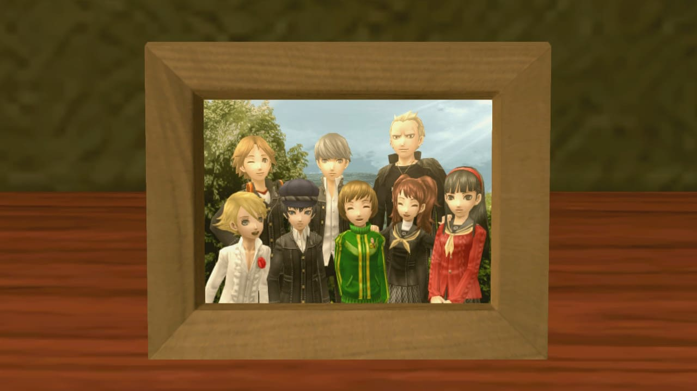
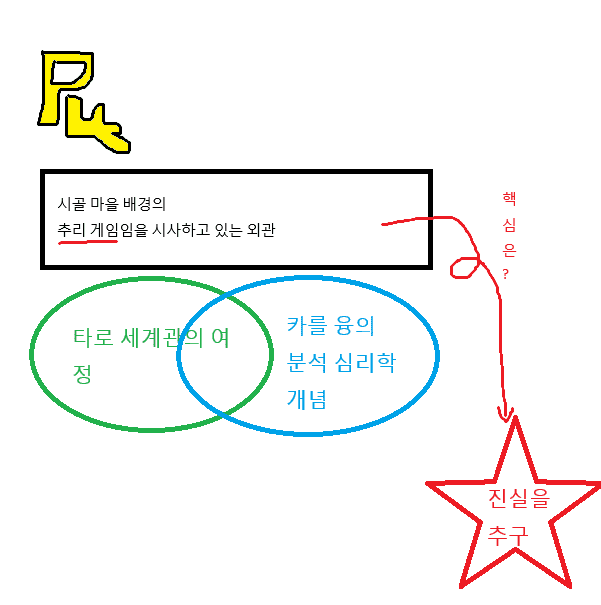
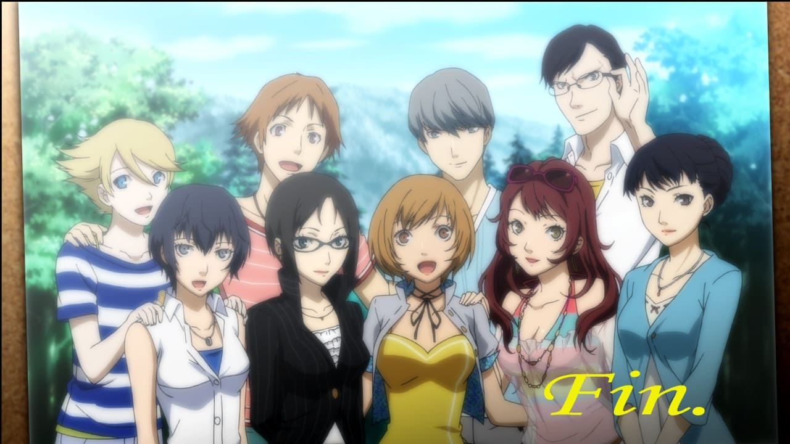
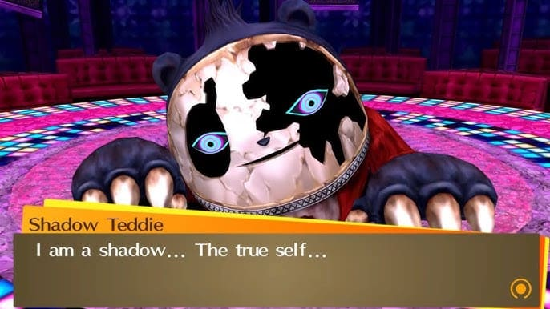
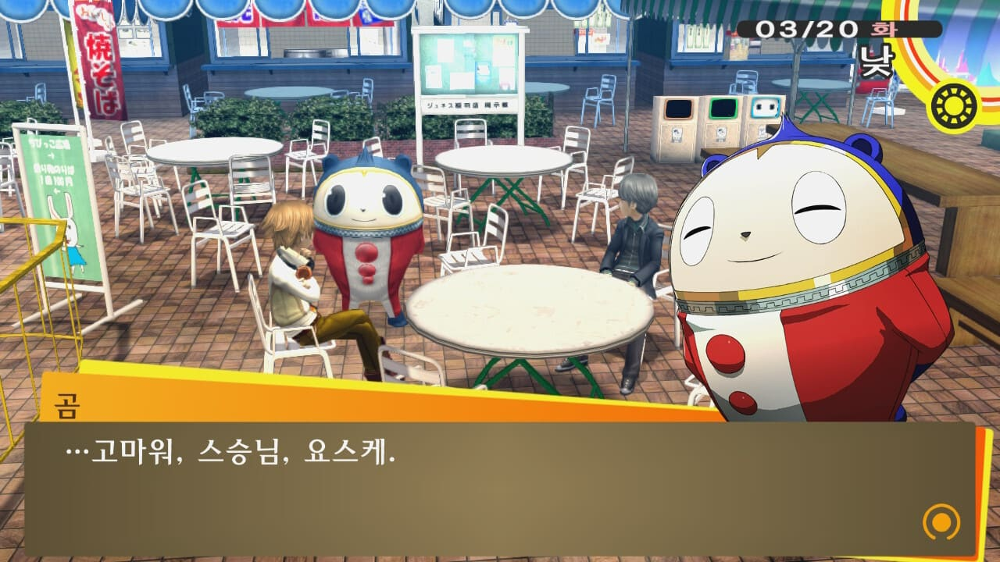
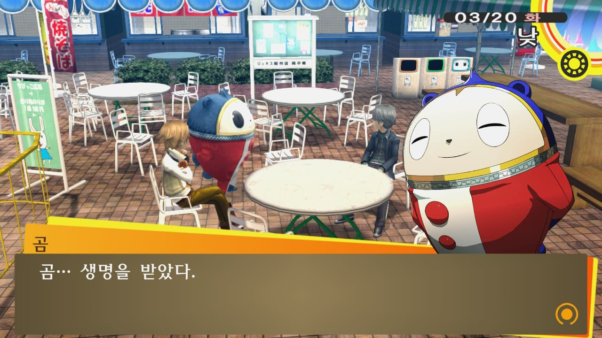

난 페르소나 시리즈를 **페르소나 4 더 골든**으로 입문했다.

(사실 옛~날에 페르소나 3 포터블을 에뮬레이터로 찍먹... 했으나 그 땐 뭐가 뭔지 몰라 타르타로스 1층 오르고 접...)
 
처음에는 이게 단순히 **시골 마을 배경 추리물 게임**인줄 알았다.

일단 페르소나 4 의 기본 세계관을 비롯한 플롯은 몇 가지의 큰 개념 요소가 결합해 있는 상태다.

다음 설명 비주얼그래프를 보자.


일단 검은 박스 안의 내용은 페르소나 넘버링 시리즈의 독자적인 외관이라고 볼 수 있다. 

P4 가 "*시골 마을 배경의 추리 게임*" 이라면, P3 는 "*미스터리한 시공간의 탑을 오르는 고등학생들의 여정*", P5 는 "*못된 어른들의 마음을 빼앗는 청춘 이야기*" 정도로 이해하면 되겠다.

어쨌든 해당 검은 박스는 붉은 실선으로 이어져 별표 도형에 도달한다.

이 별표 도형은 해당 넘버링 시리즈의 외관에 숨겨진, 그 게임의 진짜 주제라고 할 수 있겠다.

P4 는 **진실**, P3 는 **죽음**, P5 는 **반역** 정도로 대충 이해할 수 있겠고, 이렇게 각 고유 주제가 있는 반면 모든 페르소나 시리즈가 공유하고 있는 개념이 있다.

바로 **타로 세계관**과 **카를 융의 분석 심리학**이다.

---


**타로 세계관**은 처음엔 좀 어렵다.

이게 간단히 말해 카드 세트가 뭐 몇 장 이렇게 있으면, 그 모든 세트를 하나로 쳤을때 그것은 곧 인간의 인생과 같다는 것이 핵심이다.

각 카드들은 한 사람의 인생에 있어 특정 사건, 특정 때 등을 의미하며 각각 모든 카드가 의미있게 다가온다나, 뭐 그런 식이다.

이게 페르소나 시리즈의 **인연** 기능에 접목되었다.

이 **인연** 기능은 정말 중요하다, 특히 분석 심리학 개념과의 접목에 있어서.

**분석 심리학**도 나 같이 심리학 1도 모르는 사람에겐 정말 처음 접한다면 뇌가 터진다.

이게 뭐 옛날 국어 비문학 지문에서나 볼 법한 그런 말장난 식의 개념인데, 한 번 깨닫고 나면 시각이 달라진다.

## 이거다. 페르소나 시리즈를 제대로 즐기려면, 카를 융의 분석 심리학을 조금이라도 공부해야 한다.

## 한 번 이해하고 나면, 게임의 몰입감 자체가 달라진다. 진짜 미친 게임이다. 어떻게 스토리를 이렇게 구상할 생각을?

## 애초에 이 '페르소나' 라는 어휘 자체도 여기서 등장한 개념이다.
(그러니 이 분석 심리학을 모르고 단순히 삐까뻔쩍 그래픽과 UI 에 매료되어 입문한 사람들이 정신 분열 게임이라느니, 너무 스토리가 이해하기 어렵다느니 그러지...)

아 어쨌든 이번 게시물에선 이 타로 세계관이나 분석 심리학에 대해 쓸 건 아니었기 때문에 여기까지 하고, 다시 이것들이 결합된 페르소나 4 이야기로 넘어가도록 한다.

---

페르소나 4 에 있어 플롯의 핵심 사건 트리거는, **내면의 부정스런 또 다른 자신의 모습을 인정하는 것**이다.

페르소나 5 의 경우는 **내면의 자신을 더 이상 억압받게 두지 않겠다는 것**이라고 대충 생각할 수 있고, P3 는 음... 갑자기 자기 머리에 총 쏜다... 는 아니고 **죽음을 있는 그대로 받아들이는 것**이라 할 수 있겠다.

여기서 P4 의 '**내면의 부정스런 또 다른 자신의 모습**' 이란 뭘까?

이 얘기를 하려면 또 분석 심리학 얘기를 꺼내야 되는데 안 꺼내고 간략히 설명하자면, 일단 사람은 숨기고 싶은 자신의 다른 모습이 있을 것이다.

그러니까 평소의 내 모습이, 인정하기 싫은 나의 다른, 어둡고 부정적인 모습같은 거 말이다.

그 모습을 **섀도우**라 칭하고, 섀도우가 이 페르소나 4 세계관에서 큰 트리거 요소로 등장한다.


작중 등장하는 아주 밉살스럽게 귀여운, 그러나 꽃미남인 페르소나 4 의 마스코트 캐릭터의 섀도우 모습이다.

이 캐릭터는 본래 인간이 아니며, 사람들의 어떠한 욕망에 의해 태어난 초현실적 존재다. 

쉽게 말해, 우리가 인스타그램, 유튜브 릴스로 막 귀여운 춤추고 노래하는 고양이를 보고, 보고싶어하고, 만지고 싶어하고 그러는 인간들의 욕망에 따라 실제로 태어나게 된 존재 비슷한 거다.

근데 이렇게 태어난 존재가 인간들과 어울리게 되니, 본인만 어떻게 태어났는지를 모르고, 본인의 실체조차 모르는 마음이 생겨버린 거다.

"**나는 공허한 존재야**", "**내 안에는 아무것도 없어**" 그런 마음이 점점 커져만 가고 그 마음은 곧 섀도우로 실체화한다.

해당 캐릭터는 그렇게 실체화된 캐릭터와 마주하게 되고, 섀도우의 모습을 부정하려 한다.

섀도우의 모습을 부정하면 바로 그 섀도우는 평소의 내 모습을 잡아먹으려 강해진다.

왜? 평소의 본인 모습을 잡아먹으면 여태 마음 속에서 부정되어 왔던 또 다른 자신의 모습, 그러니까 섀도우가 곧 본체가 되니까.

그렇게 되면 섀도우가 마음을 점령하고 원래의 나는 죽게 되는 구조로 이 페르소나 4 의 기본 세계관은 설정되었다.

하지만, 그 보기 싫은 섀도우의 모습을 받아들이고 인정하게 된다면?

해당 섀도우를, 자신의 마음이 더욱 강해질 수 있는 발판으로 수용함으로써, 성장을 이루게 된다.

분석 심리학을 좀 공부하고 이 과정을 이해하면 스토리에서 정말 이런 하이라이트 부분마다 감동이 부르르르르~ 

```
"아무것도 없다면 처음부터 쌓아올리면 돼!"
```




---

