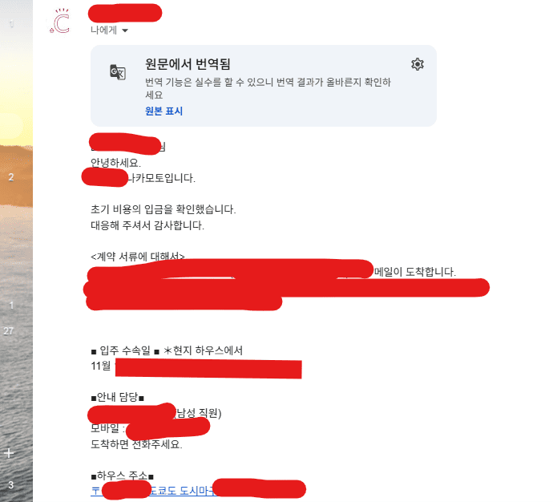
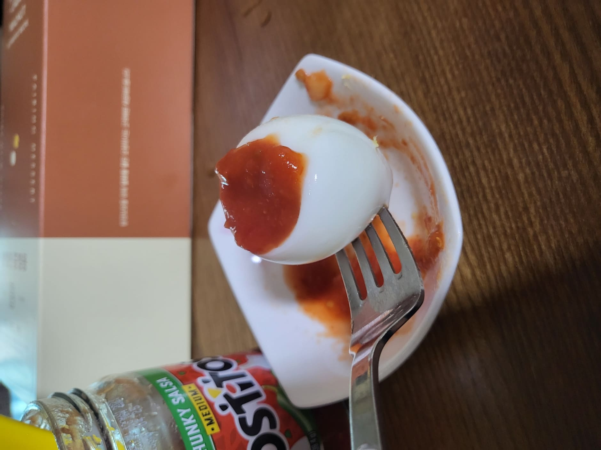
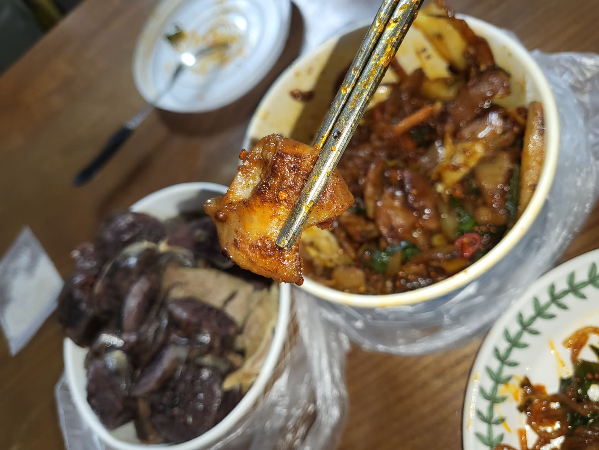
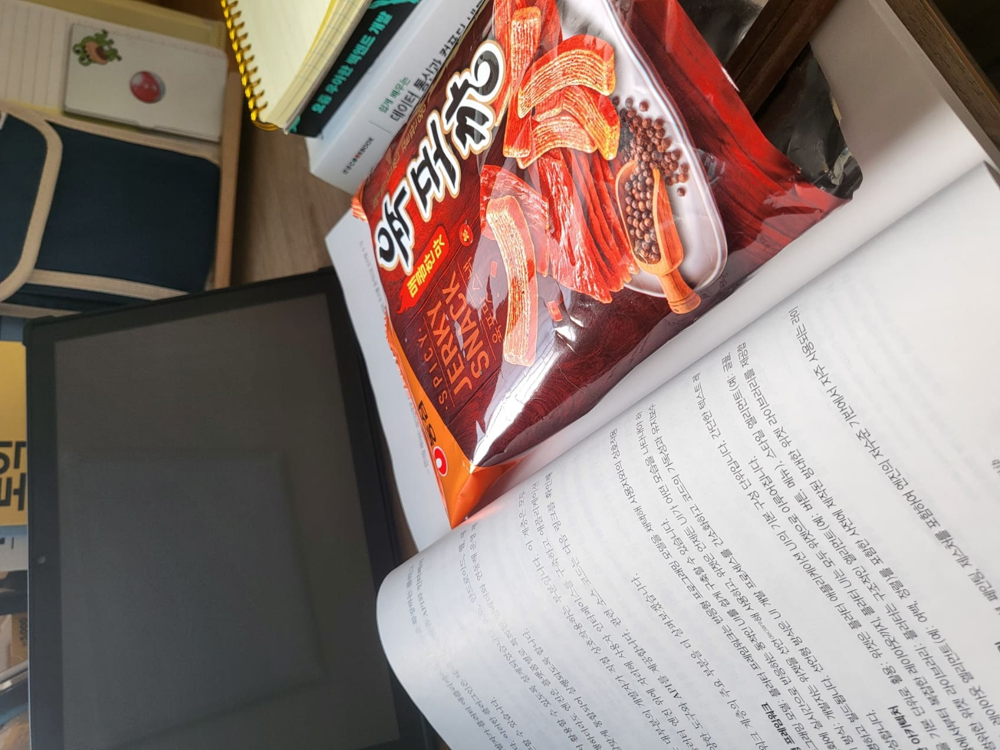

드디어 입주의 확정을 알리는 메일과 함께하는 하루.

실은 아주 마음에 들던 키치조지의 쉐어 하우스의 입주 심사에서 떨어져... 왜 떨어진지는 모르겠으나 그 이후 열심히 매물 검색을 한 결과 괜찮은 곳 하나를 찾음.

무려 엄청난 역세권에 초기 비용도 굉장히 저렴, 하지만 단점이 뚜렷해 보인다.

다만 단점은 직접 느껴보기 전엔 모르는 것임.

도쿄 23구 내에서도 상당히 중심지와 가까운 도시마구의 쉐어 하우스고 이제 직접 현지 가서 계약서 작성하고 바로 입주만 하면 되는 상태.

그러고 계란을 익혀 먹으려 함.

계란이 깨져버려서 익힘기? 속에서 아주 난리 남.

으 징그러

근데 걍 꺼내서 먹음 깨끗함 그리고 익힌 거라 상관 없죠 ㅋ

요즘 이 토스티토스? 무슨 나쵸 파는 브랜드 있는데 여기서 뭔 디핑 소스도 판다 이거야.

근데 이 디핑 소스가 정말 너무 내 스타일.

기본적으로 토마토 베이스인데 여기 마늘 + 양파 + 할라피뇨 더해진 다음 식초 베이스로 맛을 내서 아주 매콤 새콤 너무 맛있음 그냥.

하바네로 고츄 더해진 버전도 있는데 거는 상당히 매우니 조심.

쨌든 이래 나쵸나 겨란 해서 먹으면 진짜 너무 개쳐 맛있어서 사망.

이제 저녁은 집 앞 포장마차 곱창을 엄마가 사 와서 순대랑 먹어줌.

근데 너무 맛있더라.

원래 곱창이 이래 맛있나? 싶은데 원래 곱창 나 안 좋아했음.

근데 이게 은근 먹다보니 아~ 좀 먹을만한가? 하더니 계속 먹게됨.

요즘 열심히 돌리는 P3P, 아주 타르타로스 올라갈때마다 스트레스임.

스트레가?

나도 섀도 타임에 날뛰고 싶습니다. 

그리고 페르소나 3 리로드 말고 이 옛날 갬성 그래픽의 후카가 진짜 너무 이쁘고 너무 귀엽고 너무 내스타일 진짜 후카 너무 좋다 진심

후카 내가 응원할게 언제나 나는 네 편이야

참고로 글 제목의 **いきてりゃいろいろあるよな** 는 RADWIMPS 노래 가사인데 내가 좋아하는 문구임.

언젠가 후카를 !!!
