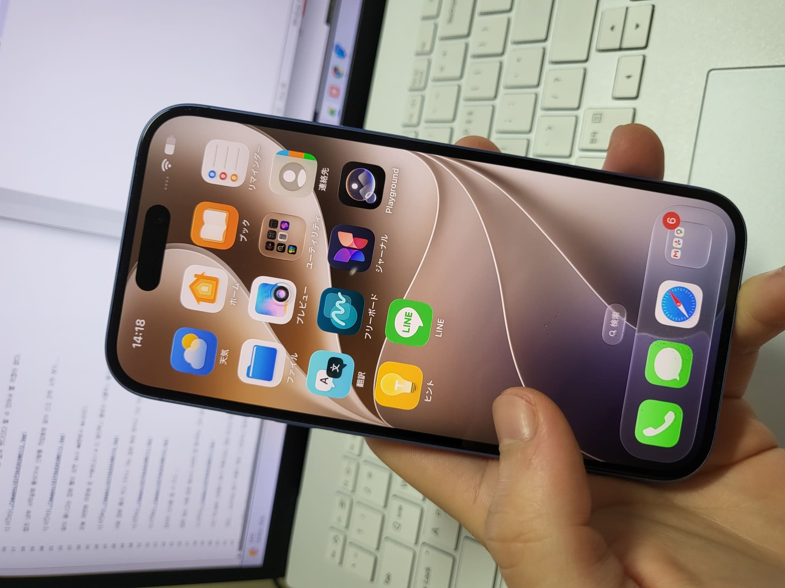
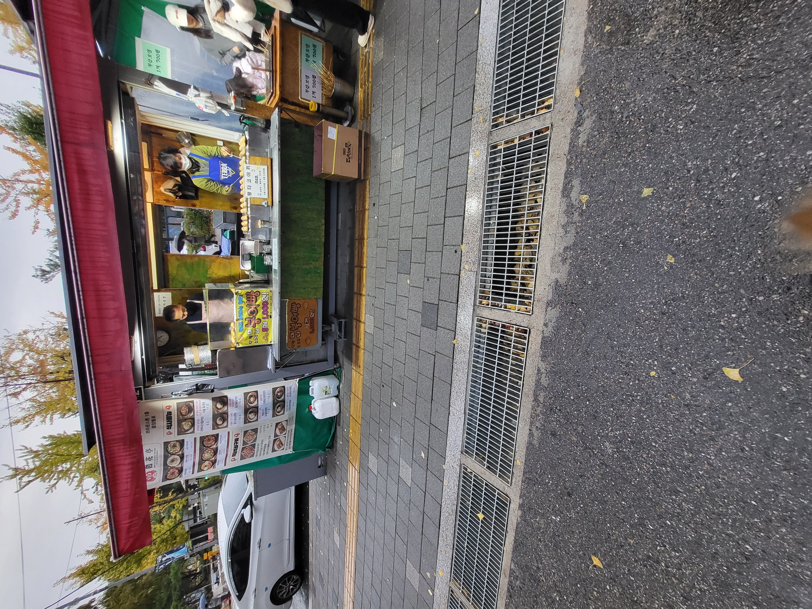
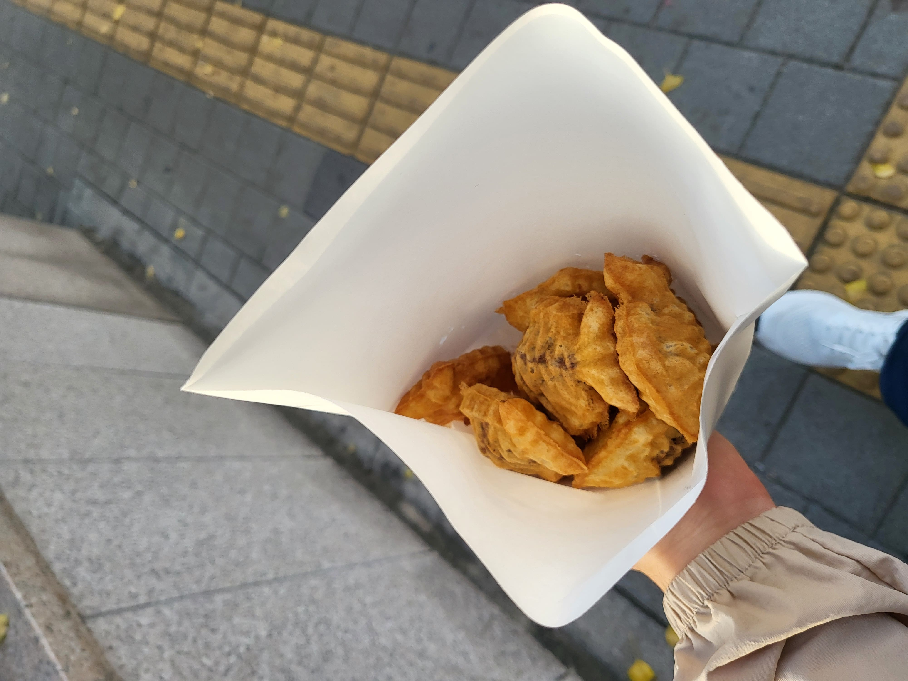
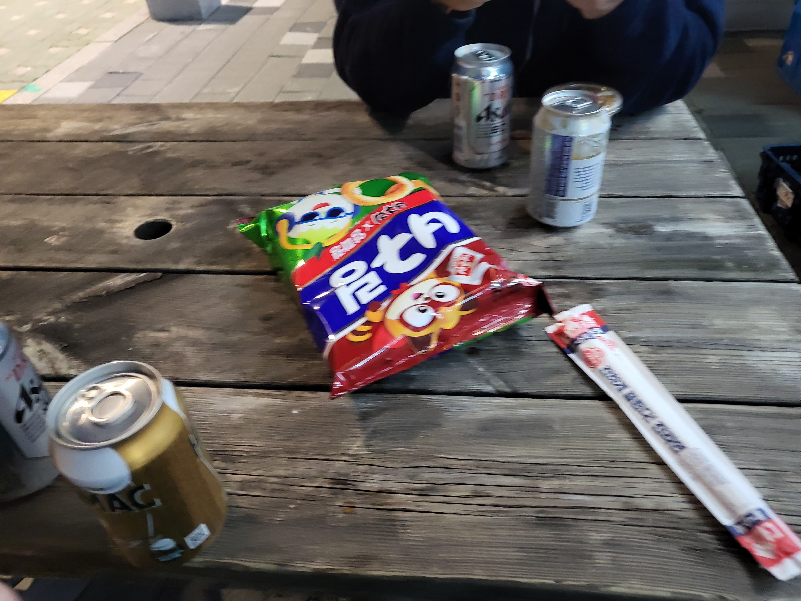
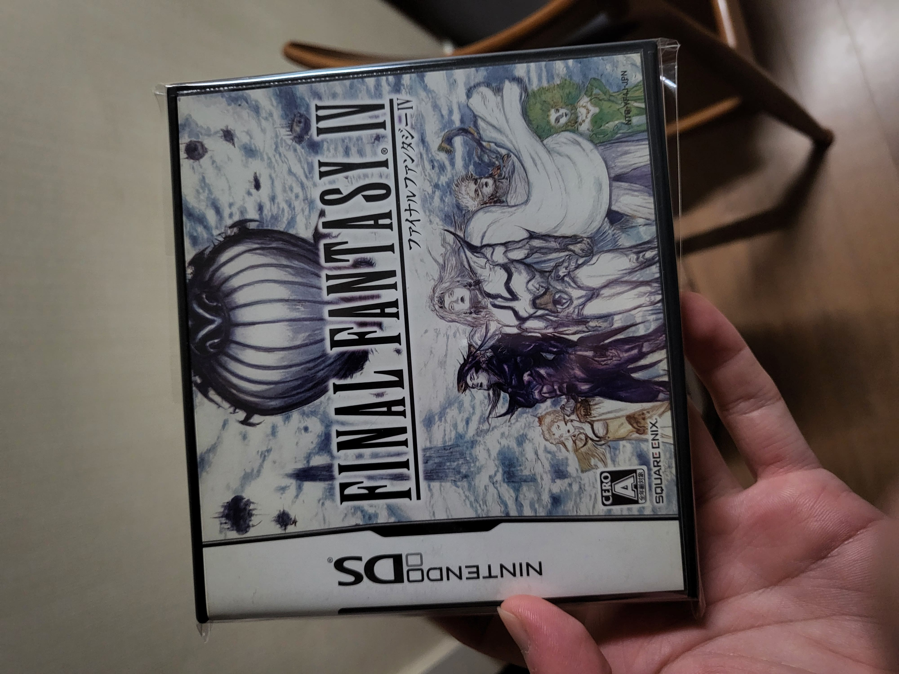
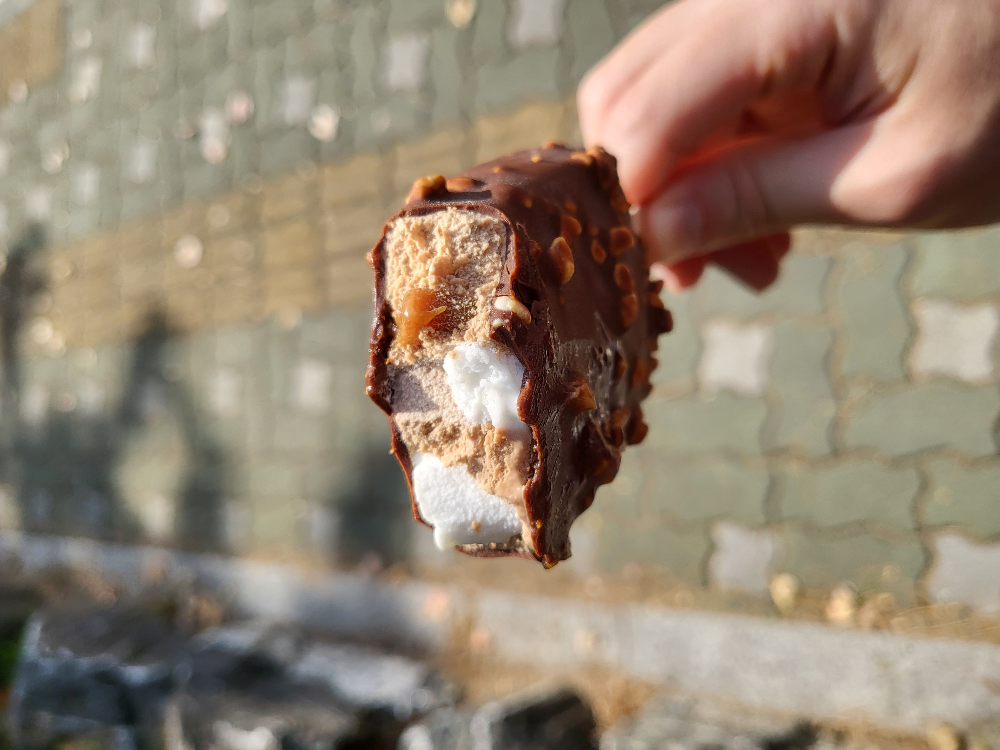

아이폰 16 삼.

지금 쓰는 폰이 4년 넘게 쓰기도 했고 배터리 수명도 한계고 또 일본이 아이폰 친화적 인프라라 쩔수없이 돈씀.

굳이 싶었으나 솔직히 지금 쓰는 폰 배터리가 병신된게 좀 큼 진짜.. 56% 에서 갑자기 방전되는 경우도 있고 충전을 해도 뭐 다섯 시간 여섯 시간 해야지 백퍼되는 경우도 있고 이게 들쭉날쭉이라 바꾸긴 해야햇퉁퉁

그리고 동네 산뽀를 나가줍니다.

그러고 주말 저녁에 마이 프렌드 간만에 만나는 친구놈을 만남.

근데 요번에 새로나온 양파링 + 너구리를 먹었는데 맛있음!!! 이거 레알 내스타일

약간 너구리 특유의 그 비릿한 라면스프맛에 매콤함 + 양파링 향 최고최고

맥주는 뭐 네캔에 마넌이라 걍 아무거나 집음

이제 인터넷으로 진짜 레전드 싸게 발견한 칩.

사실 군대있을때 클리어한 파판 4 닌텐도 DS 버전이지만 실물 닌텐도도 가지고 잇겟다 아예 칩을 물색하던 도중 정말 싼 가격의 녀석을 발견함 근데 싼 이유는 당ㅇ연히 일본어판이라서 ㅋ 근데 사실 파판 4는 스토리가 솔직히 너무 유치뽕이라 굳이 안 알아도 됨. 그래서 일판이 상관없음. 나 그래도 꽤나 스토리 진지충인데 파판 4 영어 버전으로 힘들게 깨면서(DS 판은 난이도도 개 헬)스토리 정독했는데... 음 확실히 스토리는 내 스타일 아님...

군대있을때 거의 맨날 사먹었던 구구콘이 이렇게 아이스바 형태로도 있더라고 근데 솔직히 구구콘보다 맛잇는거같음 ?

---

와 근데 내용 진짜 쓸거없다 이제 일본 워홀 2주도 안남았는데 솔직히 기대 반 무기대 반임 

음 쉐어 하우스 멤버들이나 좀 괜찮았으면... ㅋ
