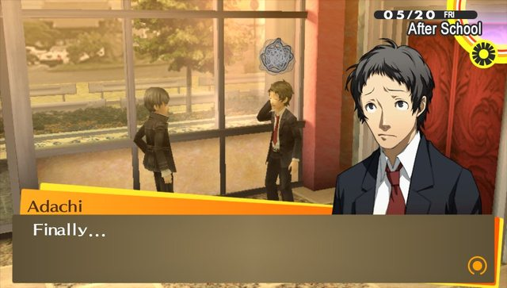
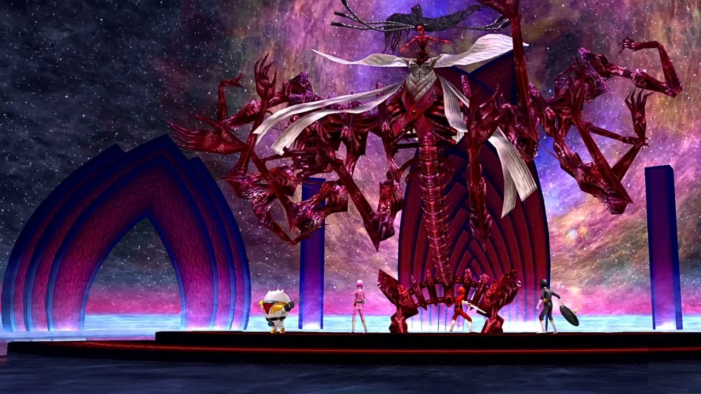

---
title:페르소나 4 진정한 흑막
date: 2026-11-05T01:00:00Z
---

https://www.reddit.com/r/PERSoNA/comments/70vm9n/just_finished_persona_4_for_the_first_time_an/

우연히 페르소나 4 세계관 그리고 플롯에 대해 공부를 좀 하던 도중에 발견한 글인데, 훌륭한 리뷰다.

댓글 또한 마찬가지.

---

게임의 전체 뼈대는 이자나미가 짜 놓은 게임판에 결국 아다치, 나마타메, 우리 주인공 세 명이서 놀아난 꼴인데, 각자 이자나미의 존재를 모름. 

게임 내에서 모든 스토리를 완결한 것만 같은 상황, 그동안 함께했던 인연들과 작별 인사를 하고 집으로 돌아가는 루트로 가게끔 개발사는 의도한 것 같다.

하지만 여기서 진실을 추구하려는 의지가 꺾이지 않은 사람이라면 진엔딩으로 향할 수 있다.

**...마지막으로 쥬네스나 한 번 더 들러볼까...**

리뷰에서 언급한 것과 마찬가지 진정한 흑막인 진실에 도달하기는 솔직히 공략 없인 힘들다.

**쥬네스? 거기 뭐 있겠어? 맨날 가던 곳인데...** 이러고 넘어가기도 쉽고...

아다치는 모든 일이 있고 나서 주인공 일행에게 편지를 보내온다.

편지의 내용은 대충... "**...근데 말이야, 나도 그렇고 너도 그렇고 이 힘은 도대체 뭐지?**" 뭐 이런 느낌으로 의문을 제기하는 내용.

진엔딩은 **진실을 추구하라**, 그렇게 추구해 도달한 곳이 **요모츠히라사카**, 이자나미가 있는 곳이다.

이자나미는 "**인간의 바램, 거짓을 믿고 싶어하는 인간에게 내가 이렇게 해 주는데 너는 뭐냐?**" 라고 하며 주인공에게 은근히 설득을 시도.

그렇게 엄청난 전투 끝에 이자나미의 확정 처형 스킬 발동.

주인공을 포함한 모든 파티원이 죽게 된다.

그러나... 재생되는 인연 씬.

먹먹한 이나바 시에서 보낸 1년간, 함께했던 인연들이 주인공을 되살려준다.

물론 진짜 죽은 것도 아니겠고 기절한? 뭐 그런 상태에서 정신 깨우침 받고 일어난거긴 한데 ㅋ

어쨌든 배틀 씬에서 나오는 이 배경음악이 진짜 레전드...

사실 이거 들려주려고 쓸데없이 서론 주구장창 늘어놨다.

<audio controls preload="none" src="./images/p4post01/TheGenesis.mp3"></audio>
최종 보스전에서 흘러나오는 이 웅장한 Reach Out To The Truth 의 오케스트라 버전...

