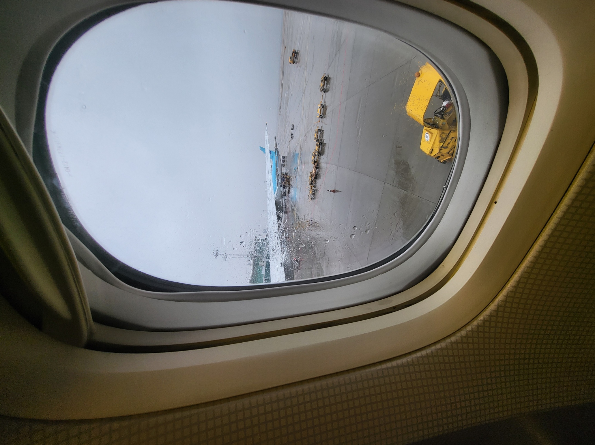
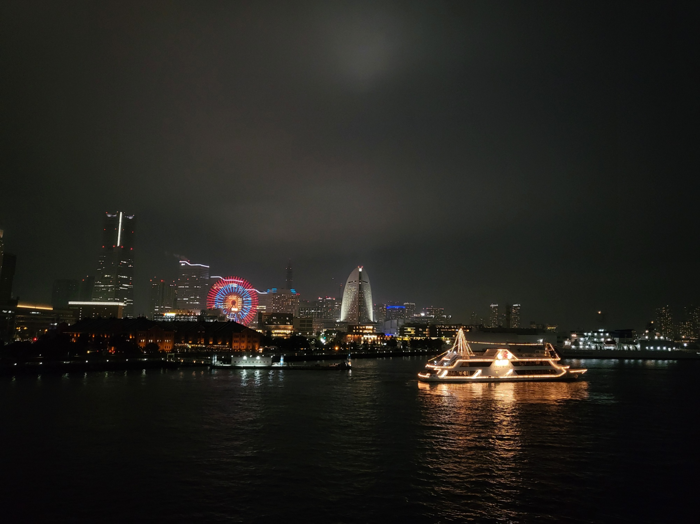
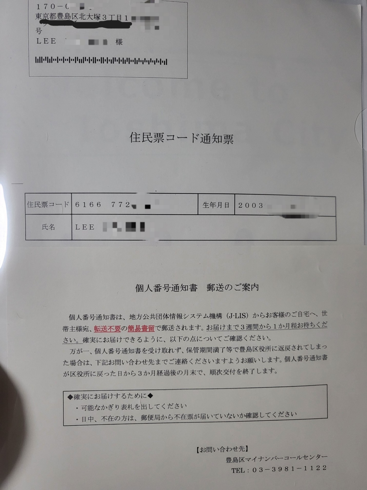
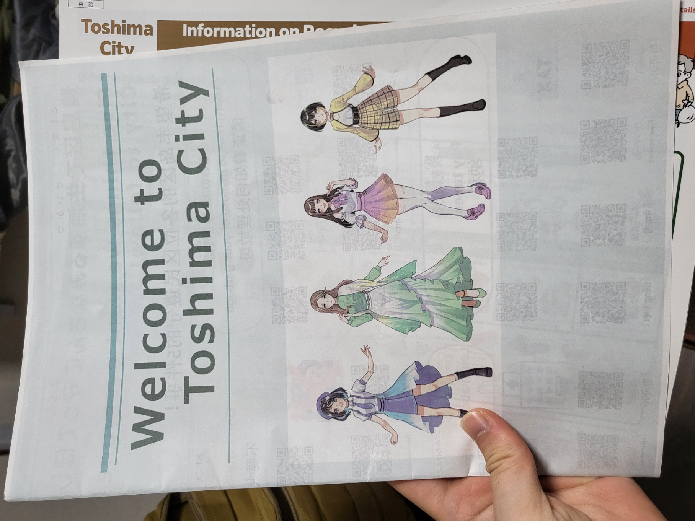
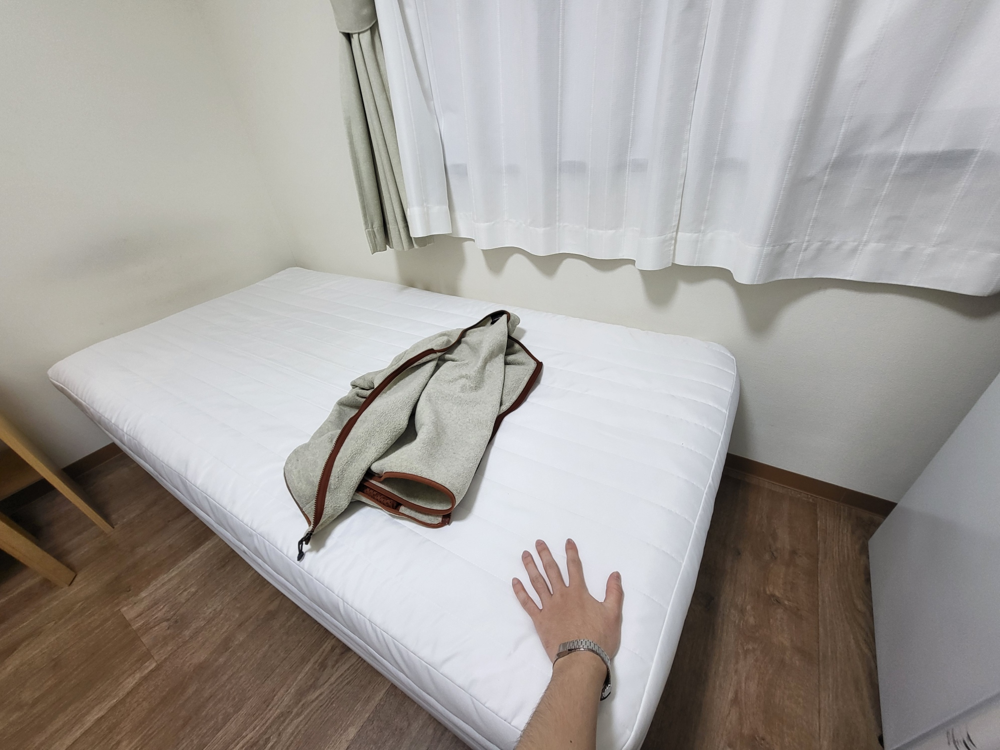
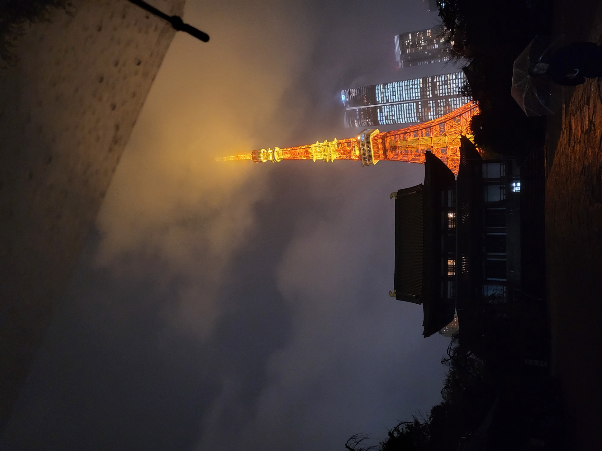
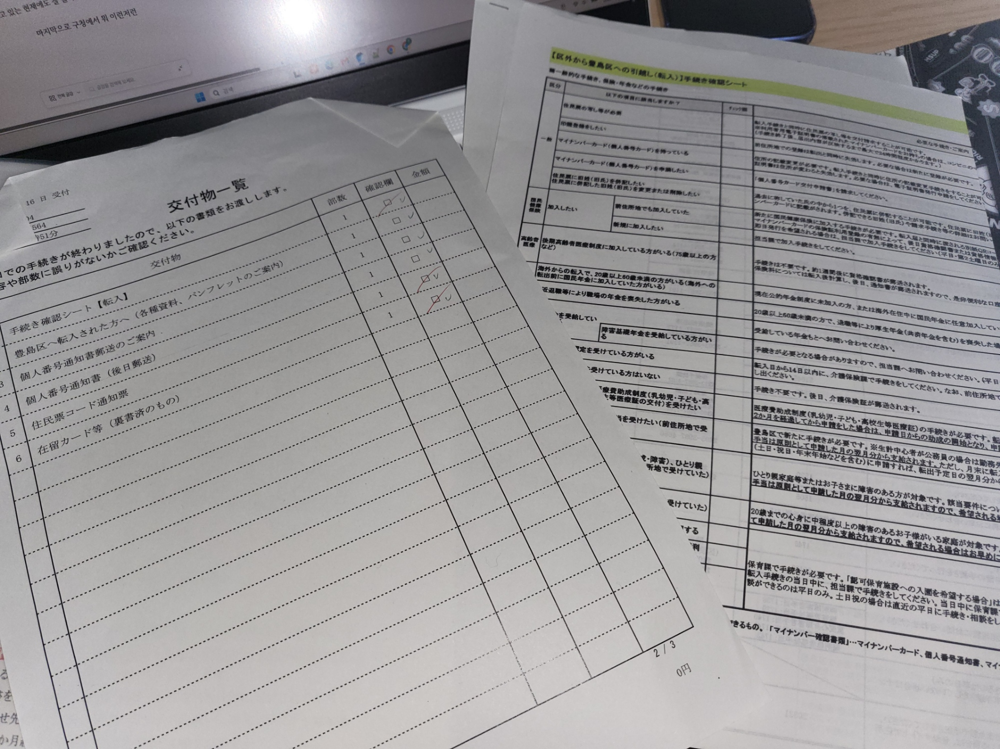
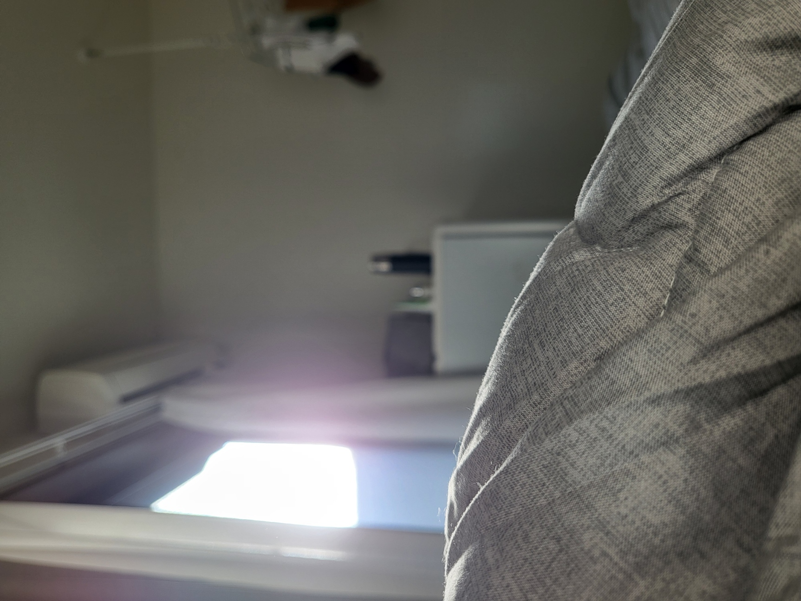
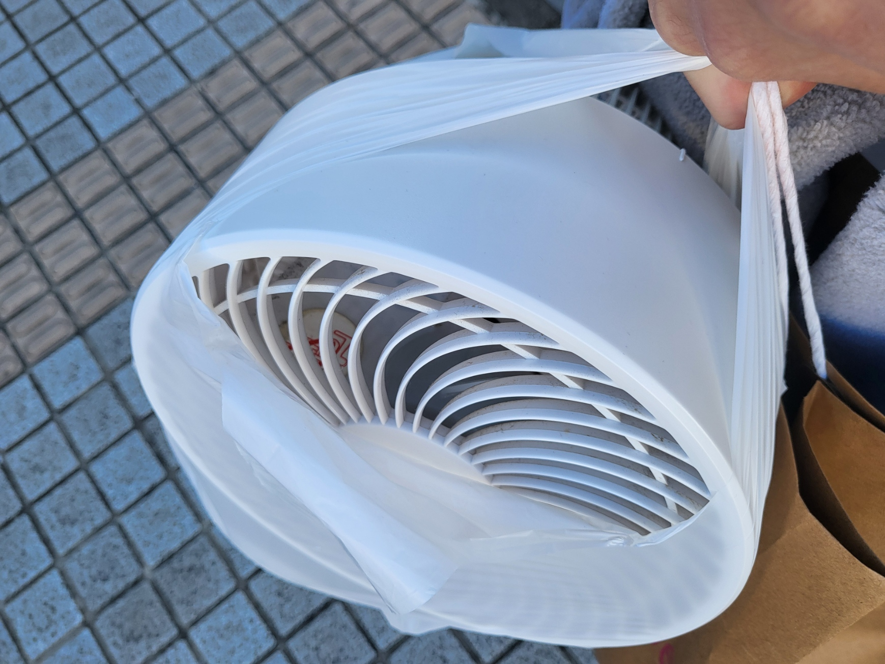

이야 드디어 워킹 홀리데이로 일본에 입국하는구만?!

입국한지 이제 6일차인데 정말 많고 많은 일이 있었다.

도쿄는 비 오더라고

입국하자마자 재류 카드 만들러 비짓 재팬 웹 QR 준비해서 어찌저찌 재류 카드 받고, 이 재류 카드 만드는 과정은 별로 안 걸렸음.

첫날은 저녁에 입국해 도쿄 숙소 가니 거의 밤 11시여서 패스, 담날 집 계약서 대면 계약 작성하러 갔고 무사히 쉐어 하우스 탐방 및 계약 절차 다 밟고 엄빠랑 요코하마 놀러감.

요코하마가 솔직히 다른 건 모르겠는데 쇼핑몰 좋게 잘 되어있는거랑 야경 이쁜거는 진짜좋은듯.?

그리고 밤에 생각보다 추웠음 도쿄보다 훨 추웠던 느낌 바람이 많이 불어서 그런가...

담날은 구청 가서 전입신고 + 보험 및 연금 관련 행정 처리.... 죨라 어려움 ㅋ

근데 하다가 중간에 한국인 만났는데 친구먹음 ㅋㅋ 실제로 동갑이라 친구임

이제 짐을 좀 숙소로 옮기며 침대 사이즈 간좀 봄. 근데 그냥 잴 필요 없이 딱 퍼펙트하게 싱글 싱글 싱글 싱글 싱글 벙글 싱글이더라고.

형도 아직 싱글입니다~

그날 밤은 엄빠가 도쿄 타워 보고싶대서 데려가 주면서~ 비가 추저저적 추저저적 내리는게 아주 갬성이 지려

심지어 비가 와서 사람들도 적고 도쿄 타워는 이쁜 빛으로 반짝이고 있고 아주 아름답드라고

울엄빠도 감성에 젖어 둘이 사진 많이 찍음

이제 구청에서 받아온 문서들 공부... 아직도 읽어야 할 게 한참 남음.

쉐어 하우스라 비교적 쓰레기 버리는거랑 시설물 관리 및 정리정돈이 수월해서 다행 ㄹㅇ

혼자였으면 할 거 쥰내게 많아서 일기쓸 시간도 없을 듯 ㅋㅋ 지금도 사실 일본 현지 어플리케이션 정리, 알바 구직, 행정 처리 계좌 개설 등등 할 거 쥰내 많음 방에 뭐 잡다하게 필요한 게 많아서 살 것도 많고 진짜 ㅋ

아니 원룸자취는 도대체 어떻게 함? 월세도 많이내고 완전히 생판 혼자 살고 뭐 첨 가면 불도 안들어오고 가스 전기도 입주전 신청하고 돈 대줘야 나온다고 하니... 쉽지 않노 이래서 쉐하쉐하 하는가 ㅋㅋ 쉐하 이야기는 다음 다른 게시물에서 해 보겠음.

나의 첫 쉐하에서 맞이하는 첫 아침, 진짜 기모찌찌~~ ♡♡♡♡

한 8시 정각쯤에 눈떴는데 햇빛 이래 들어오고 같은 층 옆방 사람사는 소리 들리고 하고 일본이고 오늘 할 것도 있고 하니 아주 상쾌포쾌짱쾌

오전에 구청에서 만난 친구랑 반말까고 이제 진짜로 친구 먹고 오후에 근처역 중고거래 감.

나같은경우 군대에 있을때 헤어드라이기 없어서(물론 말년때 보급 비슷하게 중대에 하나 나온게 있긴 했는데 ㅋ 개인거쓰면 간부가 존나뭐라했음 )선풍기로 맨날 애지게 머리채 볶다보니 습관되서 전역하고 집에서도 선풍기, 추워져도 선풍기, 일본와서도 선풍기 없인 머리 못 말리겠음

어쨌든 오늘 쪼~금 밀린 벌써 지나가버린 6일간의 이야기 끝