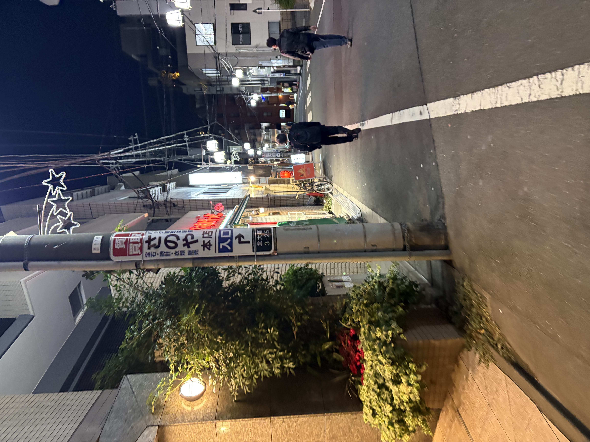
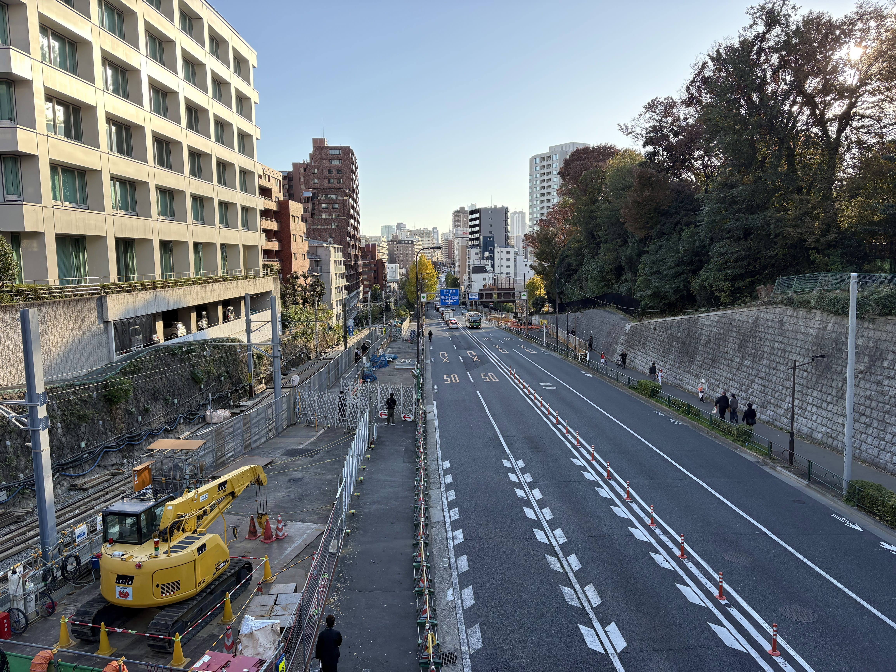
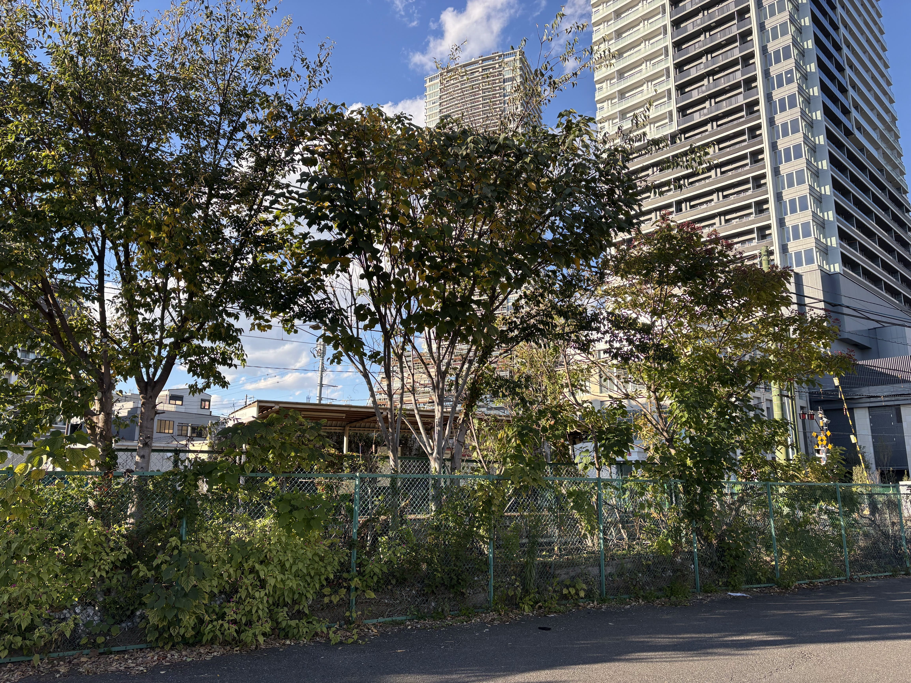
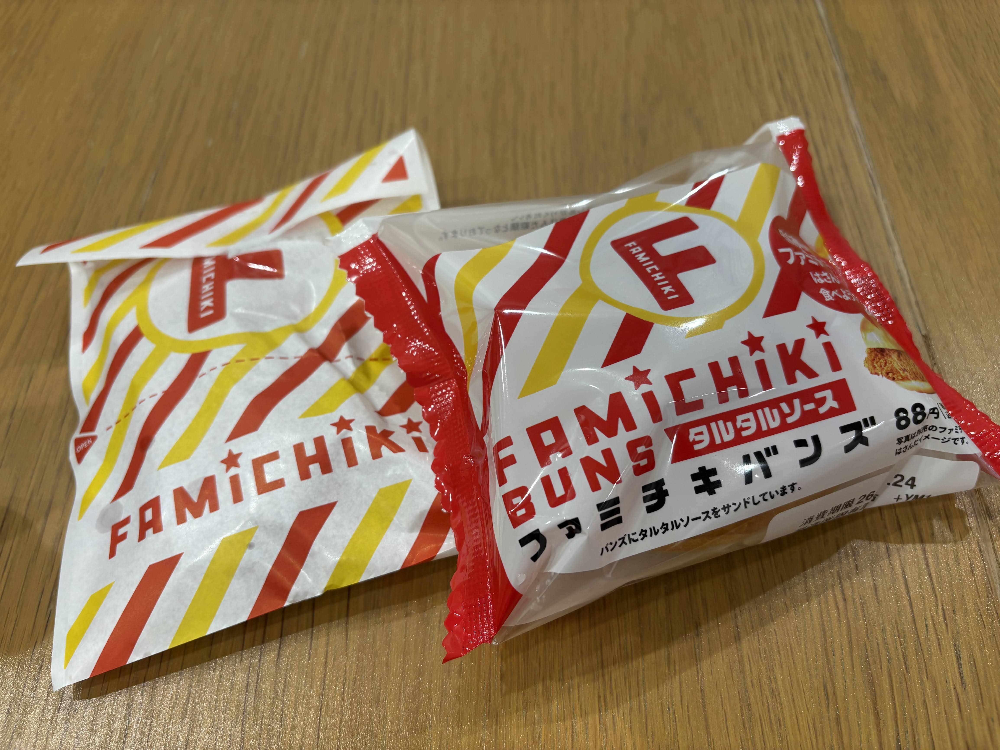
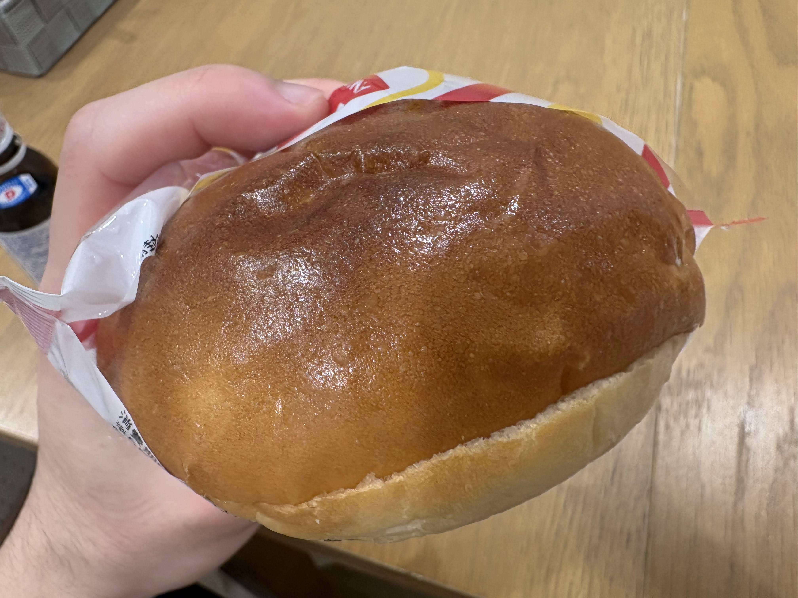
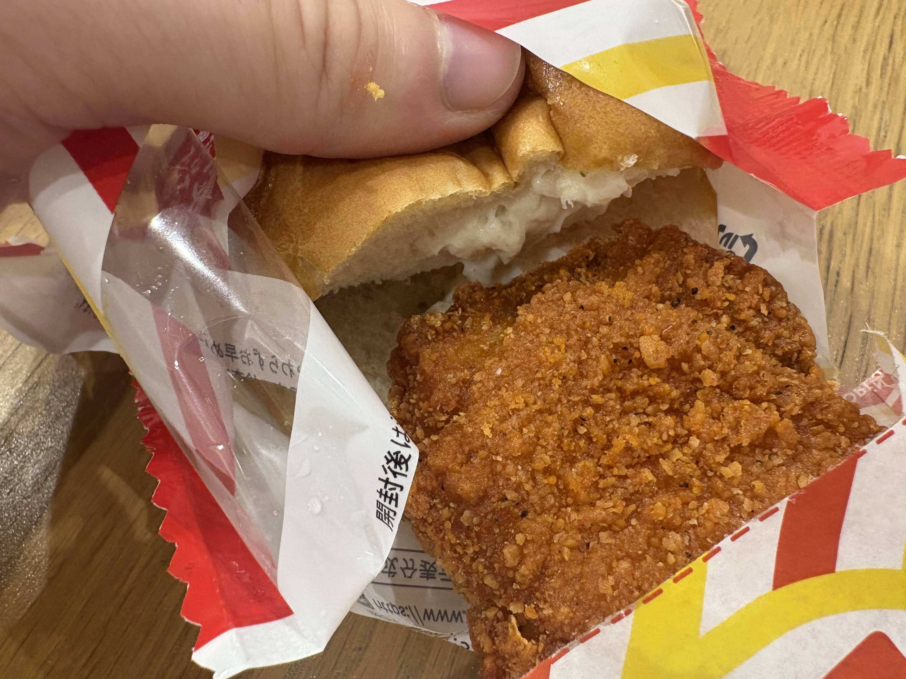
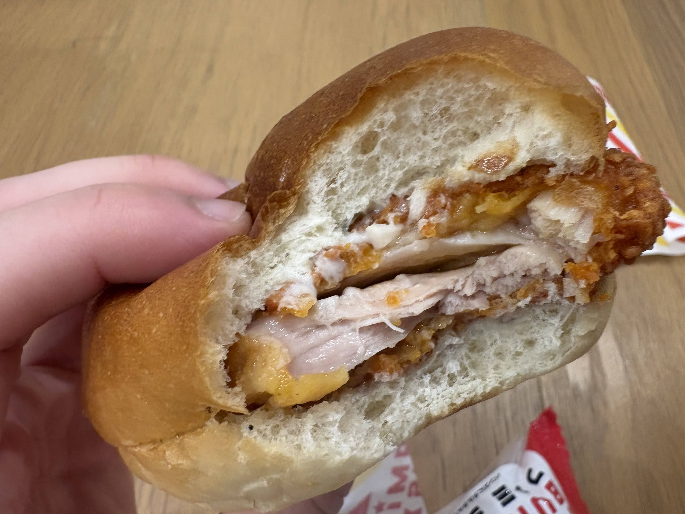

매일 매일이 할 게 없는 것 같으면서도 은근히 할 게 많다.

일단 지금 최소한의 소비... 를 하려고 노력 중이지만 방금도 집 앞 저녁 세일 아이템들 몇 가지 주워 왔...

일단 이번 주 월요일에 신청한 유쵸 은행 계좌 개설이 오늘 아침에 연락이 와서 바로 체크, 일단 개설은 성공이나 실제로 사용하려면 실물 카드가 배송되어야 하기 때문에 좀 더 기다려야함.

어... 근데 문제는 당장 다음주에 야칭후리코미를 해야 한다는 것.

앞 방 사는 행님 왈, 원래 현금으로 갖다줘도 문제 없었는데, 요번 달부터 ATM 입금으로만 받는다고...

그래서 당장 어찌 캐시 카드 없이 송금해야하나 고민중...

내일 일단 **미즈호 은행**이 무통장 입금이 가능하다고 해서 가보려고 함.

그리고 아르바이트 어플 여러 개 다운받아서 지원 중인데, 확실히 N1 취득만 달아놓아도 지원만 하면 바로 연락이 옴.

"어? 여기서 연락을 준다고?" 싶은 곳도 몇 있음...

물론 내가 다소 고평가하는 알바처일수도 있겠는데 진짜 별 생각 없이 다 넣어봤는데 생각보다 막 메일이랑 앱 알림이랑 너무 혼란스럽게 연락이 와서 뭐가 뭔지 모르겠음.

일단 지금 면접까지 잡힌 데가 맥날, 하브스, 뭐 저기 야키니쿠 집인데 솔직히 나느 맥날을 디폴트로 잡고 다른 거는 어찌해야될지를 모르겠음.

맥날이 손님들도 디게많고 재밋을거같고 일단 좋은게 직원 할인 무려 30%가 들어가서 개혜자임 그럼 진짜 거의 2천 3천원에 점심 저녁 아침 다 해결 가능 이게 너무 큼

그리고 오늘 갑자기 희소식인데 앞방 행님이 시부야 어디 저 뭐 오코노미야끼였나 야키니쿠였나 그런데서 일하는데 거기 사장님이 한국 사람 엄청 좋아한대서 뭐 같이 알바 하자고 그러셔가지고 한 번 가보긴 할려고

---

이제 슬슬 매일은 아니더라도 러닝을 좀 하려는데 코스 탐방을 지금부터 하러 갈 거임.

여기다가 대충 코스 사진을 올려봄.

도덴 아라카와 선이라고, 다른 말로 사쿠라 트램이라는 개귀여운 도심 노면전차 라인이 하나 있는데 그 열차 옆길따라 달리는 코스가 유명하다고 함.

자 일단 오오츠카역앞에서 트램을 타고 와세다 방면, 언덕을 올라가면 무코하라 역이 나옴.

우리 쉐어 하우스에서 나오면 언덕길이 하나 있는데 이 언덕이랑 저기 무코하라로 가는 언덕이 이어져 있어서 여기서부터 뛰기 시작함.

트램길이라 은근 역간 간격이 짧아서 한 500m? 간격으로 역이 계속 있는듯?

그렇게 계속 뛰어서 와세다쪽 슬슬 진입하면 내리막길이 나옴.

이동네가 전체적으로 내려가는 구조라 어떤데는 계단타고 내려가고 어떤데는 급경사고 그런데 어쨌든 거기서도 뛰어서 내려감. 

그니깐 오츠카쪽에서 와세다방면 트램타면 거의 다가서 좌회전하는데 여기까지 가면 사실상 끝임.

여기부터 조용하고 뛰기좋은 강변숲길같은거 나오는데 여기 전반적으로 한번싹 뛰어준다음 와세다역에서 트램타고 오오츠카역 복귀 완벽 시나리오 ㅋ

자~ 이제 복귀하고 편의점에서 박카스 하나랑 파미치키 셋토~ 사버렸디~

